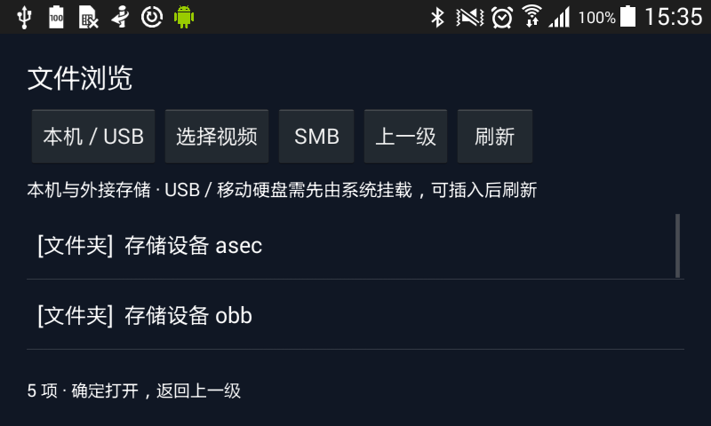
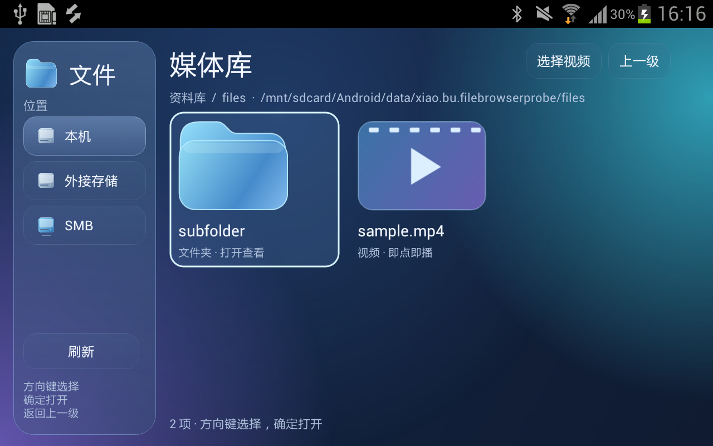
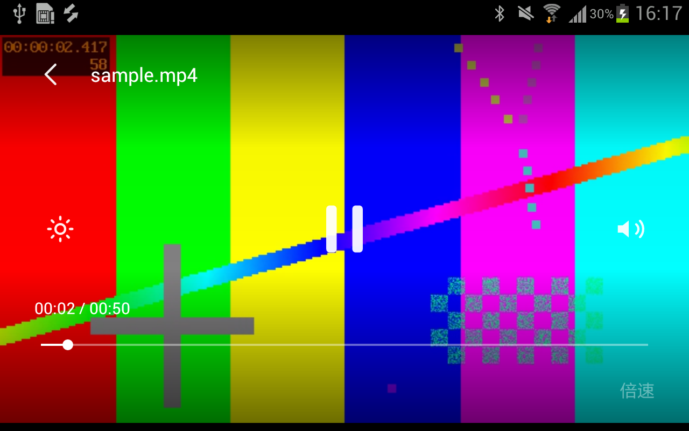
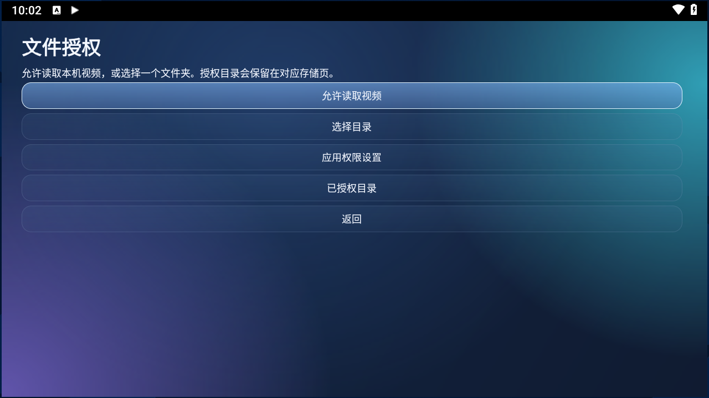

# 文件浏览频道插件

原生独立 JAR 插件，支持 Android 4.0 / API 14 及以上，适配目标包括 Android 4.0.4 / API 15。入口 `FileBrowserPlugin.create()` 返回单个 View，不注册 Activity、Service 或 WebView。

## 使用

- **本机 / 外接存储**：浏览本机存储及系统已挂载、应用可读的 U 盘和移动硬盘。插拔设备后点击“刷新”。文件夹排在前面，仅显示视频和子目录。
- **文件授权**：Android 6+ 检查宿主已声明的读取权限及 AppOps 限制；Android 13+ 对应视频读取权限。未授权时提供“允许读取视频”“选择目录”“应用权限设置”及“已授权目录”。从设置返回后自动重新检查，不把拒绝访问显示为空目录；宿主未声明权限时可改用目录授权。新版 nTv 管理页支持上传并直接打开“文件浏览”插件。
- **选择视频**：调用系统文件选择器；设备需要安装能处理该请求的文件管理器。
- **选择目录**：位于“文件授权”内，Android 5.0+ 使用系统目录授权。持久读取权限与目录名称记录在对应本机/外接存储页，重启后仍可打开；已授权目录不依赖广泛存储读取权限。可访问系统文档提供器支持的 USB 存储；电视缺少文件选择器时有明确提示。Android 4.0.4 直接浏览挂载目录，不调用新系统接口。
- **SMB**：打开后自动扫描当前局域网，实时列出开放 SMB 端口的设备 IP。选择设备后自动尝试免密连接；免密共享不需要填写账号密码。需要认证或服务器不允许枚举共享时，可在连接页补充账号或共享路径。也可点击“手动连接”，输入 `smb://192.168.1.10/共享名/`，支持中文、空格和子目录。支持 SMB 2.0.2 / 2.1 / 3.0 / 3.1.1，包括 SMB 3 的 AES-CMAC 强制签名。保留自定义端口的共享枚举，免密共享允许无会话签名密钥的访客枚举。**不支持 SMB 1 或强制 SMB 传输加密的共享**；不会自动降低服务器要求。
- 遥控器上下选择、确定进入或播放、返回逐级退出并恢复原卡片焦点。网格左边缘进入侧栏，侧栏向右返回网格；授权/连接/扫描/播放页隐藏背景焦点。播放时确定暂停/继续、左右跳转 10 秒，菜单键或向下键聚焦播放控件；进度条获得焦点后左右同样跳转 10 秒。触摸控制条可拖动进度。

SMB **边读边播**，不先下载完整视频、不写视频缓存。每次播放创建仅监听 `127.0.0.1`、带随机路径令牌的 HTTP 流式代理。支持 HEAD、单段 Range、尾段和开放范围，随机读取直接定位远端文件。每连接 64 KiB 缓冲、最多四条传输连接。停止、返回或退出插件时关闭代理；SMB 请求超时为 8–10 秒。后台暂停视频，回前台恢复此前正在播放的视频。

播放器复用“网页电视”的原生 `VideoControlsOverlay` 控制层，支持进度拖动、亮度/音量手势与遥控器。底层解码使用 API 14 已有的系统 `VideoView` / `MediaPlayer`，视频容器和编码支持取决于设备系统解码器；插件不会把扩展名识别当作解码能力保证。Android 4.x 的 USB 文件系统支持及挂载权限取决于电视/盒子 ROM；应用不能访问系统未挂载或未授权的设备。新系统可改用“选择目录”授权。

只保存 SMB 地址、用户名和域；密码只在当前插件会话内使用，不拼进媒体 URL、不写偏好、不输出到日志。连接失败时可重新进入 SMB 表单修改账号。

自动发现使用当前网络接口的 IPv4 网段和 TCP 445，Android 4.0.4 使用 8 条并发探测，较新系统使用 16 条，每次连接最多等待 500 ms；离开扫描页立即取消并关闭连接。较大网段只扫描包含本机地址的 /24 范围，多个接口最多合计 1024 个地址；页面会提示范围限制。跨网段、IPv6、非标准 SMB 端口及禁止端口探测的设备请使用手动地址。开放端口只是发现线索，实际共享权限在连接时确认。

## 玻璃界面与旧系统性能

深蓝渐变背景、通透侧栏和蓝色立体图标，按用户参考图实现。图标与文字使用独立布局和 9dp 标题间距，卡片图标等比绘制，与标题共用左边线，标题和说明基线统一。

- 256×144 静态背景只生成一次并作为不透明纹理复用，不做实时模糊或背景采样。
- 四类 224×196 透明图标缓存复用；背景和图标总像素内存约 0.81 MiB。
- 卡片复用视图，文本裁切与图标布局在绑定/尺寸变化时计算；不在 `onDraw` 中新建材质、文字或位图。
- 不自动扫描视频封面，不对整个目录逐个提取视频帧。
- 控制层隐藏或后台时停止刷新；4.0.4 加载转圈按约 32ms 间隔，仅在加载界面可见时运行。
- 原生控制层来源与原文件 SHA-256 在 `shared-controls.json` 中记录；独立插件携带同源代码，不要求更新宿主 APK。

## 构建与导入

```powershell
python plugins/file-browser/build.py --sdk D:/android/sdk --java-home C:/path/to/jdk8
```

需要 Python 3.9+、JDK 8+ 和 Android SDK android-30 / build-tools 30.0.3。自动下载并校验 Android API 14 平台及固定 SHA-256 的依赖。基础入口另外使用 API 14 存根编译，现代存储方法保留在受版本判断保护的单独类中，R8 `--min-api 14` 生成 DEX。

`backport.py` 在构建时将 jcifs-ng 中旧系统缺少的 `Objects`、`StandardCharsets` 改为插件内兼容实现，将 `AutoCloseable` 接口改为旧系统已有的 `Closeable`。这些修改及第三方许可见 NOTICE。下载的原始依赖保留不变。另将旧系统不提供的 Cp850 默认 OEM 探测替换为 US-ASCII；SMB1 禁用，SMB2 路径继续使用 Unicode。

输出：`dist/file-browser.jar`、`dist/file-browser.sha256`、`dist/example.m3u`。本仓库的 [example.m3u](dist/example.m3u) 已配置在线 JAR 和 SHA-256，可在 nTv 导入其原始文件 URL。自行部署时替换 JAR 的 HTTPS 地址，保留对应构建的 SHA-256。

## 验证

```powershell
python plugins/file-browser/tests/run.py
# 额外的真实 SMB2 回环服务器验收，在隔离 Python 环境中安装：
pip install -r plugins/file-browser/tests/requirements.txt
python plugins/file-browser/tests/run.py --smb
# 免密码共享：
python plugins/file-browser/tests/run.py --smb --guest
python plugins/file-browser/tests/verify_artifact.py
```

测试实际 HTTP 套接字、Range/HEAD、非法范围、令牌、请求方法、只读取请求字节及关闭端口和文件句柄；SMB 测试使用账号认证，读取含中文和空格的文件名，核对远端随机读取的字节。固定 Impacket 0.12.0；较新版本的回环服务在本测试中出现会话签名互通失败，生产插件保留签名校验。

v1 已在三星 SM-G3608（Android 4.4.4 / API 19）使用独立测试 APK 加载当时的 JAR，验证本机目录/过滤、640×360 H.264/AAC 实际解码、时钟推进、遥控器暂停继续/跳转、前后台恢复，以及经局域网 SMB2 账号认证后读取中文文件名、实际播放和关闭端口。限速 SMB 服务在出现播放画面时仅传输约 1.90 MB，文件总大小约 11.80 MB，确认无需完整下载才开始播放。详见 [真机验证记录](VALIDATION.md)。

真机测试后将 SMB 初始化移入后台，修复 Dalvik EnumSet 依赖的枚举反射方法被裁剪，以及 Android 系统 BC 包同名且缺少 MD4 的问题。加密依赖迁入插件私有包，以私有 Provider 提供 NTLM MD4 和 SMB3 AES-CMAC，不修改系统的加密 Provider。

测试入口（先使用 FFmpeg 生成 `.codex-tmp/file-browser/fixture/sample.mp4`，至少 40 秒 H.264 Baseline/AAC）：

```powershell
python plugins/file-browser/tests/build_device_probe.py
adb -s 设备序列号 install -r .codex-tmp/file-browser/device/probe.apk
python plugins/file-browser/tests/run_device.py --serial 设备序列号 --host 电脑局域网IP
# 使用免密测试共享：追加 --guest
# 4.0.4 的 600 项目录与绘制/主线程响应观测：追加 --perf
```

设备需能访问电脑 TCP 39628，且电脑 TCP 445 服务可用于扫描验证；测试输出在 `output/file-browser/`，包含结果、画面和实际 SMB 读取字节统计。探针测试本机选择时提供固定测试文件，不将其算作系统文件选择器验收。

v4 已在用户 Android 9 模拟器通过真实系统目录选择、持久授权/进程重启、受限存储下播放、遥控器焦点，以及 Impacket/Samba 多协议测试。模拟器将存储权限视为安装时授权，未实际弹出运行时拒绝/允许对话框；AppOps 与系统目录授权路径已验证。实体 USB 插拔、Windows/NAS 厂商设备和 Android 13+ 仍未实测；独立插件测试不代替完整宿主验收。

Android 4.0.4（GT-N7005 / API 15）已完成本机、免密 SMB2 实际播放与性能观测，详见 [验证记录](VALIDATION.md)。软件绘制耗时及主线程排队间隔是测试观测，不是显示帧率或无卡顿承诺。

## 4.0.4 真机界面

来自 GT-N7005 的实际截图，仅旋转为横向展示；系统 CPU 叠层在截图时暂时隐藏，结束后恢复。








## Android 9 与 SMB 矩阵复现

先按上文构建并安装探针，准备至少 40 秒的 H.264/AAC 视频；探针仅使用独立包和测试目录。

```powershell
python plugins/file-browser/tests/run_storage_device.py --serial 127.0.0.1:21503 --video C:/path/sample.mp4
# Windows + WSL Ubuntu-22.04（已安装 Samba），以及 requirements.txt 中的 Impacket 0.12.0：
python plugins/file-browser/tests/run_smb_matrix.py --serial 127.0.0.1:21503 --video C:/path/sample.mp4
# 仅复测指定案例：追加 --only impacket-guest,samba311-signed
```

Samba 使用临时配置、独立密码数据库和回环端口，不修改系统 SMB 配置；ADB reverse 连接这些临时服务，结束后移除。矩阵包含免密、错误密码后重试、中文/空格目录、自定义端口枚举、字节范围校验、实际解码/跳播和端口释放。失败预期用例为 SMB1-only 与强制加密共享。服务端 `smbstatus` 同时记录实际协商协议与签名算法。`run_storage_device.py` 调用真实系统选择器，以遥控器确定完成授权，第二进程在 AppOps 受限时重开已保存目录。



模拟器 ADB 截图在系统选择器返回后出现黑帧，未作为目录/播放器截图发布；解码尺寸、时钟及原生首帧回调由探针验证。

追加的 Android 7.1.1 与 Android 17 / API37 真机已识别，但 USB 安装被系统拒绝，等待设备解锁与允许安装；尚未记为通过。探针可用 `build_device_probe.py --target-sdk 37` 构建新系统宿主变体，再运行同一权限/SMB 测试。
