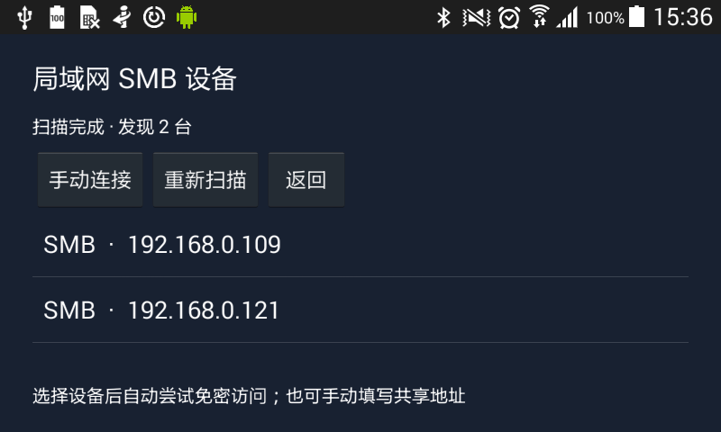

# 文件浏览频道插件

原生独立 JAR 插件，支持 Android 4.0 / API 14 及以上，适配目标包括 Android 4.0.4 / API 15。入口 `FileBrowserPlugin.create()` 返回单个 View，不注册 Activity、Service 或 WebView。

## 使用

- **本机 / USB**：浏览本机存储及系统已挂载、应用可读的 U 盘和移动硬盘。插拔设备后点击“刷新”。文件夹排在前面，仅显示视频和子目录。
- **选择视频**：调用系统文件选择器；设备需要安装能处理该请求的文件管理器。
- **选择目录**：Android 5.0 以上显示，使用系统目录授权，可访问系统文档提供器支持的 USB 存储。Android 4.0.4 直接浏览挂载目录，不调用新系统接口。
- **SMB**：打开后自动扫描当前局域网，实时列出开放 SMB 端口的设备 IP。选择设备后自动尝试免密连接；免密共享不需要填写账号密码。需要认证或服务器不允许枚举共享时，可在连接页补充账号或共享路径。也可点击“手动连接”，输入 `smb://192.168.1.10/共享名/`，支持中文、空格和子目录。使用 SMB 2 / 3，不启用 SMB 1。
- 遥控器上下选择、确定进入或播放、返回逐级退出。播放时确定暂停/继续，左右跳转 10 秒；触摸播放控制条可拖动进度。播放结束返回原目录。

SMB **边读边播**，不先下载完整视频、不写视频缓存。每次播放创建仅监听 `127.0.0.1`、带随机路径令牌的 HTTP 流式代理。支持 HEAD、单段 Range、尾段和开放范围，随机读取直接定位远端文件。每连接 64 KiB 缓冲、最多四条传输连接。停止、返回或退出插件时关闭代理；SMB 请求超时为 8–10 秒。后台暂停视频，回前台恢复此前正在播放的视频。

播放器使用 API 14 已有的系统 `VideoView` / `MediaPlayer`，视频容器和编码支持取决于设备系统解码器；插件不会把扩展名识别当作解码能力保证。Android 4.x 的 USB 文件系统支持及挂载权限取决于电视/盒子 ROM；应用不能访问系统未挂载或未授权的设备。新系统可改用“选择目录”授权。

只保存 SMB 地址、用户名和域；密码只在当前插件会话内使用，不拼进媒体 URL、不写偏好、不输出到日志。连接失败时可重新进入 SMB 表单修改账号。

自动发现使用当前网络接口的 IPv4 网段和 TCP 445，最多 24 条并发探测，每次连接最多等待 500 ms；离开扫描页立即取消并关闭连接。较大网段只扫描包含本机地址的 /24 范围，多个接口最多合计 1024 个地址；页面会提示范围限制。跨网段、IPv6、非标准 SMB 端口及禁止端口探测的设备请使用手动地址。开放端口只是发现线索，实际共享权限在连接时确认。

## 构建与导入

```powershell
python plugins/file-browser/build.py --sdk D:/android/sdk --java-home C:/path/to/jdk8
```

需要 Python 3.9+、JDK 8+ 和 Android SDK android-30 / build-tools 30.0.3。自动下载并校验 Android API 14 平台及固定 SHA-256 的依赖。基础入口另外使用 API 14 存根编译，现代存储方法保留在受版本判断保护的单独类中，R8 `--min-api 14` 生成 DEX。

`backport.py` 在构建时将 jcifs-ng 中旧系统缺少的 `Objects`、`StandardCharsets` 改为插件内兼容实现，将 `AutoCloseable` 接口改为旧系统已有的 `Closeable`。这些修改及第三方许可见 NOTICE。下载的原始依赖保留不变。

输出：`dist/file-browser.jar`、`dist/file-browser.sha256`、`dist/example.m3u`。本仓库的 [example.m3u](dist/example.m3u) 已配置在线 JAR 和 SHA-256，可在 nTv 导入其原始文件 URL。自行部署时替换 JAR 的 HTTPS 地址，保留对应构建的 SHA-256。

## 验证

```powershell
python plugins/file-browser/tests/run.py
# 额外的真实 SMB2 回环服务器验收，在隔离 Python 环境中安装：
pip install -r plugins/file-browser/tests/requirements.txt
python plugins/file-browser/tests/run.py --smb
# 免密码共享：
python plugins/file-browser/tests/run.py --smb --guest
python plugins/file-browser/tests/verify_artifact.py
```

测试实际 HTTP 套接字、Range/HEAD、非法范围、令牌、请求方法、只读取请求字节及关闭端口和文件句柄；SMB 测试使用账号认证，读取含中文和空格的文件名，核对远端随机读取的字节。固定 Impacket 0.12.0；较新版本的回环服务在本测试中出现会话签名互通失败，生产插件保留签名校验。

已在三星 SM-G3608（Android 4.4.4 / API 19）使用独立测试 APK 加载最终 JAR，验证本机目录/过滤、640×360 H.264/AAC 实际解码、时钟推进、遥控器暂停继续/跳转、前后台恢复，以及经局域网 SMB2 账号认证后读取中文文件名、实际播放和关闭端口。限速 SMB 服务在出现播放画面时仅传输约 1.90 MB，文件总大小约 11.80 MB，确认无需完整下载才开始播放。详见 [真机验证记录](VALIDATION.md)。

真机测试后将 SMB 初始化移入后台，修复 Dalvik EnumSet 依赖的枚举反射方法被裁剪，以及 Android 系统 BC 包同名且缺少 MD4 的问题。加密依赖迁入插件私有包，以私有 Provider 提供 NTLM MD4，不修改系统的加密 Provider。

测试入口（先使用 FFmpeg 生成 `.codex-tmp/file-browser/fixture/sample.mp4`，至少 40 秒 H.264 Baseline/AAC）：

```powershell
python plugins/file-browser/tests/build_device_probe.py
adb -s 设备序列号 install -r .codex-tmp/file-browser/device/probe.apk
python plugins/file-browser/tests/run_device.py --serial 设备序列号 --host 电脑局域网IP
# 使用免密测试共享：追加 --guest
```

设备需能访问电脑 TCP 39628，且电脑 TCP 445 服务可用于扫描验证；测试输出在 `output/file-browser/`，包含结果、画面和实际 SMB 读取字节统计。探针测试本机选择时提供固定测试文件，不将其算作系统文件选择器验收。

尚未完成 Android 4.0.4 真机播放、实体 USB 插拔、Windows/NAS SMB3 服务器、系统文件选择器及 nTv 完整宿主集成验收；4.4 的独立插件测试不代替这些项目。

## 真机界面

Android 4.4.4 独立测试窗口的实际截图，仅旋转为横向显示。



